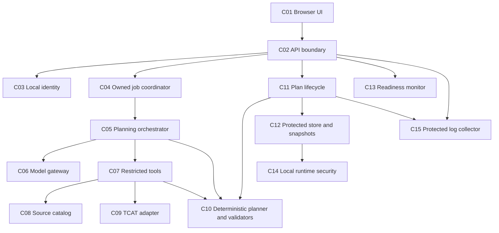
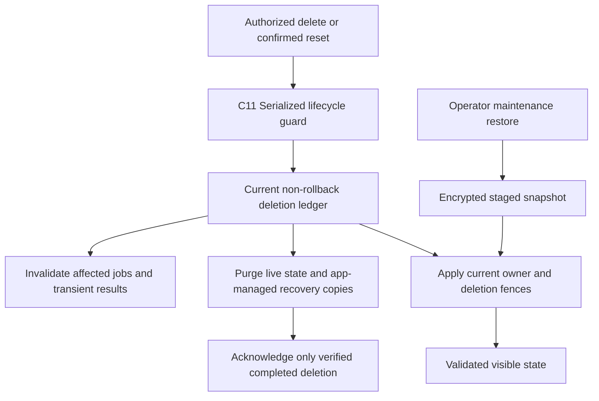

# BigRedRoutes — Component Dependencies and Data Flow

**Status:** APPROVED. Exact user response “Approve & Continue”, recorded 2026-11-24T17:34:08Z in `../../audit.md`. No implementation, OS configuration or test success is implied.

## Permitted direct dependency matrix

Rows list all permitted direct component calls. These are runtime relationships, not units or an implementation order. A read-only trust/status dependency is not permission to mutate its store.

| Caller | Permitted callees | Communication / restriction |
|---|---|---|
| C01 BrowserUI | C02 | Same-origin HTTPS; no filesystem/model/database calls |
| C02 ApiBoundary | C03, C04, C08, C11, C13, C15 | Authorization first; direct protected reference/plan/status reads; submit/cancel jobs; safe events |
| C03 LocalIdentity | C14, C15 | Protected key/config verification and safe auth events; identity revocation state read by job guards |
| C04 JobCoordinator | C03, C05, C11, C15 | Owner/session and read-only lifecycle guard checks; call orchestrator under shared accepted-time budget; no model text in events |
| C05 PlanningOrchestrator | C06, C07, C08, C09, C10, C11 | Read saved version/evidence, interpret/plan/validate; returns candidate rather than directly saving it |
| C06 ModelGateway | None | Restricted external local Ollama endpoint; no component/repository authority |
| C07 ToolRegistry | C08, C09, C10 | Registered read/validate tools only, no lifecycle mutation |
| C08 SourceCatalog | C14 | Read-only validated catalog files in verified protected runtime paths |
| C09 TcatAdapter | C14, C15 | OS-authorized import/cache paths, safe import events; no raw feed logging |
| C10 DomainPlanner | None | Pure typed domain logic; no I/O/model/identity dependency |
| C11 PlanLifecycle | C03, C10, C12, C14, C15 | All mutation guards, domain validation, repository/snapshot, protected readiness and required events |
| C12 ProtectedStore | C14 | Verified encrypted local paths/key availability; called through lifecycle only |
| C13 ReadinessMonitor | C04, C06, C08, C09, C12, C14, C15 | Bounded read-only status ports, never a mutation or raw-data escape |
| C14 RuntimeSecurity | None | OS keystore/permissions/encrypted-volume/HTTPS configuration boundary |
| C15 ProtectedLogCollector | None | Independent OS identity owns encrypted retained logs and safe aggregate alerts |

**Lifecycle-to-job invalidation:** C11 does not synchronously call back into a running C04 job while holding mutation locks. It advances authoritative session/plan/deletion guards and publishes a safe invalidation event on an in-process event port. C04 subscribes, cancels work and discards results; C11 never relies on timely event delivery for safety. Current authoritative guards are checked atomically before any mutation and before a result is exposed. This avoids a circular orchestration dependency and a missed-event deletion race.

**Shared budget/guards:** C04 gives C05/C07 a request-scoped capability object with deadline/cancellation/session/deletion checks; it is a port, not a direct import of the coordinator's mutable implementation. No source/model callback may call C11 save/delete/restore. The browser performs explicit save/confirmation through C02/C11 after inspecting the candidate.

## Planning data flow

**Text alternative:** Browser submits/polls through the authorized API. The owned job coordinator invokes planning. Planning uses model proposals and restricted evidence tools, then deterministic validation, and returns a transient candidate. An explicit save request crosses the API and sole lifecycle boundary into protected storage/snapshots. Runtime security supplies encrypted-path/key readiness; an independent collector receives safe events. Readiness returns aggregates only. The graph shows principal flows; the matrix above is the authoritative complete direct-call list.

## Delete/reset and restore data flow

**Text alternative:** An authorized mutation establishes the current durable deletion fence and invalidates affected work. Live/snapshot/staging copies are purged or rewritten before a complete receipt. Restore stages an encrypted snapshot and applies the current owner/deletion fences before validating/exposing any state. Older snapshots cannot replace the current fence; missing/corrupt fences fail closed. Cancel/event delivery is helpful for resource cleanup, but mutation/result safety depends on authoritative guard checks, not asynchronous delivery alone.

## Trust and data classifications

| Data/boundary | Handling |
|---|---|
| Raw chat, draft job result | Bounded transient process memory, expiry/logout/delete/shutdown cleanup; no SQLite, logs, backup or browser persistent storage |
| Saved itinerary and constraints | Owner-scoped structured data through C11, encrypted runtime storage and snapshots |
| Deletion ledger/current owner | Encrypted protected durable state outside replaceable plan snapshot; no itinerary bodies; never roll back on restore |
| Bootstrap/session/key material | OS-protected config or transient credential/session state; never model context/logs/repository |
| Public source text/model output | Untrusted input; schema/applicability/provenance validation before use; no instruction authority |
| Security events | Safe typed metadata to independently owned protected collector; no raw private plan or prompt |
| Source archive/import staging | Local operator-authorized, bounded extraction to encrypted paths; no runtime use of synthetic fixtures |

Detailed lock order, cancellation/commit linearization and archive/time algorithms remain Functional Design obligations. This graph does not prove their correctness; it defines the interfaces and invariants those designs must preserve.
