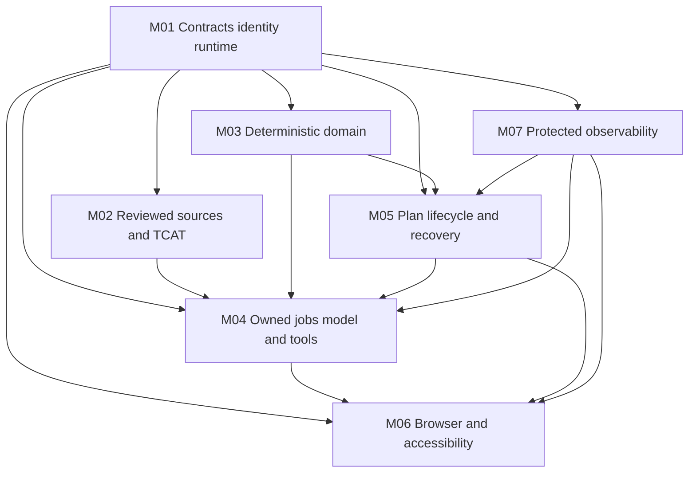

# BigRedRoutes — Unit and Work-Package Dependencies

**Status:** APPROVED. Exact user response “Approve units and stop before Construction”, recorded 2026-11-24T17:44:20Z in `../../audit.md`. Inception complete; Construction not started.

## Unit-level matrix

| Unit | Depends on another application unit | Supporting runtime dependencies |
|---|---|---|
| U01 BigRedRoutes | None — the entire modular application is one unit | Local OS identity/encrypted storage/HTTPS, Ollama, and separately OS-owned protected collector integration delivered/configured within U01 |

There is no U02 and no inter-unit network/service graph to invent. Supporting processes retain their security/ownership boundaries even though the team selected one delivery unit. The decomposition below makes work manageable without changing that choice.

## Logical work-package construction prerequisites

`D` means an agreed interface/implemented port is a construction integration prerequisite. A dash means no direct construction prerequisite, not “never calls it at runtime”. Rows are consumers; columns are prerequisite packages. Runtime relationships remain the approved `component-dependency.md`, not this matrix.

| Consumer | M01 | M02 | M03 | M04 | M05 | M06 | M07 |
|---|---|---|---|---|---|---|---|
| M01 Contracts/identity/runtime | - | - | - | - | - | - | - |
| M02 Sources/TCAT | D | - | - | - | - | - | - |
| M03 Deterministic domain | D | - | - | - | - | - | - |
| M04 Jobs/model/orchestration | D | D | D | - | D | - | D |
| M05 Lifecycle/storage/recovery | D | - | D | - | - | - | D |
| M06 Browser experience | D | - | - | D | D | - | D |
| M07 Protected observability | D | - | - | - | - | - | - |

| Package | Prerequisite port/checkpoint | Integration qualification |
|---|---|---|
| M01 | None | Define identity, typed results/guards/safe events/runtime-readiness contracts first. Collector readiness can use a contract fixture while its real implementation is not yet integrated; never claim final secured readiness from a fixture |
| M02 | M01 | Source review/catalog curation can proceed while interfaces stabilize. Pure/source tests need no live model; real operator import acceptance also needs protected runtime/logging from M01/M07 |
| M03 | M01 | Use typed evidence and generated/synthetic domain inputs; domain code must not depend on source I/O/model/DB implementations |
| M07 | M01 | Implement independent collector against neutral safe-event schema and protected aggregate ports. It must not import app business code or depend on completed planning/jobs/lifecycle |
| M05 | M01, M03, M07 | Version/auth/domain checks, protected event emission and store readiness before integrated stateful acceptance. Lifecycle guard interfaces can be implemented without running jobs |
| M04 | M01, M02, M03, M05, M07 | Implement owned jobs/tool/model orchestration against stable source/domain/lifecycle guard/event ports; validate cancellation/delete/version integration before exposing results |
| M06 | M01, M04, M05, M07 | UI work may start against typed fixtures, but real end-to-end acceptance waits for secured job, lifecycle and aggregate status ports |

**Topological checkpoint order:** M01; then M02/M03/M07 against stable contracts; then M05; then M04; then M06/integrated acceptance. Parallel human work against contract fixtures is possible; no delegation to extra coding agents or independent AI-DLC workflow is implied. No package is declared tested/complete merely because its prerequisite is documented.

## Dependency diagram

**Text alternative:** Contract/identity/runtime interfaces come first. Sources, pure domain logic and the protected collector can then be developed against them. Lifecycle integrates domain/trust/event ports. Jobs/model orchestration integrates sources/domain/current lifecycle guards. Browser end-to-end acceptance integrates these real protected interfaces. Arrows indicate prerequisite to consumer and the graph is acyclic; it is not the runtime call graph.

## Data ownership and cycle avoidance

- M05 alone owns saved-plan SQLite mutation, non-rollback deletion ledger and snapshot/restore protocol. M04 proposes candidates; M06 requests an explicit authorized save. Model/tools have no repository write access.
- M01 owns stable local owner/session authorization and shared contract definitions. Client/model owner claims are never authority.
- M02 owns reviewed source/cached-import records and permission/applicability checks; M03 consumes typed evidence without importing adapters.
- M07 owns protected event collection and aggregate status. Its separate OS identity controls its encrypted log files; app code has no rewrite/delete/raw-read access. A neutral versioned safe-event schema breaks any collector→business-code dependency.
- Lifecycle deletion/session invalidation uses authoritative fences plus an event port. M05 does not synchronously call a running M04 worker under its locks; M04 checks current lifecycle/session guards before publishing/committing and discards affected results. Event delays cannot permit resurrection.
- Readiness observes bounded read-only ports. It does not make M07's collector depend on the whole application being healthy, and a status observation grants no mutation access.
- Old snapshots cannot replace current owner/session/deletion/epoch state. Runtime encrypted paths/key configuration are supplied by M01, not chosen by model/source input.

## Integration checkpoints within U01's later Construction lifecycle

1. **Contract checkpoint:** Shared typed records/statuses, owner/session guard, source stamps, version/confirmation rules and safe-event schema agree across modules. No implementation success is inferred.
2. **Local trust/evidence checkpoint:** Verify encrypted paths, session/HTTPS/key/collector boundaries; reviewed catalogs and local feed validity; isolate pure domain behavior. Stubs do not satisfy final security or genuine-source acceptance.
3. **Lifecycle checkpoint:** Demonstrate versioned authorized save, honest snapshot status, deletion/reset fences and maintenance restore before jobs can depend on them.
4. **Job/agent checkpoint:** Demonstrate accepted-time queue budget, owner poll/cancel, safe tool limits, truthful fallback and no restart replay/late writes; test current guards with concurrent delete/logout/expiry.
5. **Traveler checkpoint:** Both modes, confirmed windows, partial-plan questions, provenance/budget, revisions, local plan management, accessibility and aggregate status work together.
6. **Final verification checkpoint:** Applicable Security/Resiliency/PBT obligations, concrete story criteria, source/model feasibility, restore and measured performance/coverage checks are complete with actual evidence.

These checkpoints organize work inside the single approved unit. They do not replace AI-DLC per-unit Functional/NFR/Code Generation approvals or integrated Build and Test. Inception ends after generated-unit approval; none of these checkpoints is executed now.

## Later-stage decisions retained

Functional Design must settle temporal/archive algorithms and cancellation/commit/delete/restore crash ordering. NFR Design must obtain the user decisions about CI/release/rollback, incident response and resiliency testing that were deliberately deferred. Exact package pins, OS setup, tool behavior and all security/PBT/performance checks require actual Construction verification. No cloud infrastructure or extra unit is implied by a local setup problem.
