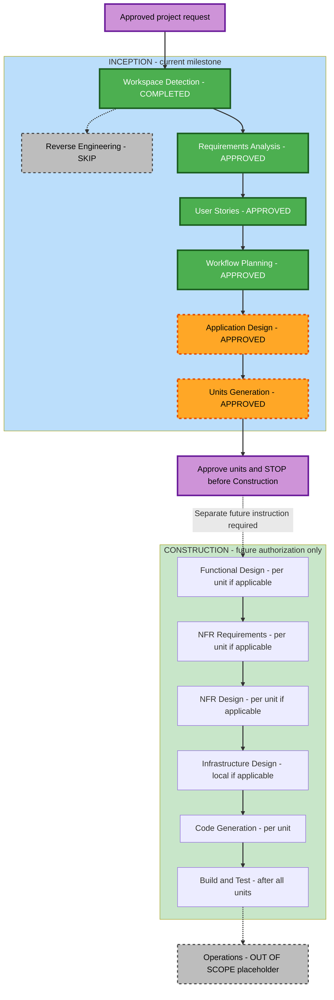

# BigRedRoutes — Execution Plan

**Status:** APPROVED. Exact user response “Approve & Continue”, recorded 2026-11-24T17:17:10Z in `../../audit.md`. Application Design planning is next; its own answer/approval gates still apply.
**Workflow:** Installed AWS AI-DLC v1.0.1. This is the formal lifecycle execution plan, distinct from the approved story-generation plan.
**Boundary:** Finish Inception including approved Units Generation, then STOP. Construction requires a later, separate project instruction; approval of this plan does not start it.

## 1. Context and detailed scope analysis

**Greenfield:** No application exists. `examples/` contains technical-input illustrations only. Reverse Engineering and brownfield package migration/update analysis are N/A.

**Approved evidence:** `../requirements/requirements.md` (22 FRs, 14 NFRs), all three answered requirements question files, `../user-stories/stories.md` (24 stories, 72 criteria), `../user-stories/personas.md` (four archetypes, supporting operator), and actual approvals in `../../audit.md`. Requirements and generated User Stories are approved; design and units are not yet produced or approved.

| Impact area | Scope |
|---|---|
| User-facing | General NYC/DC itineraries; Cornell campus-origin/NYC transport research; window confirmations; partial-plan decisions; revisions; local saved-plan lifecycle |
| Structure | New UI/API, source adapters, bounded model orchestration, deterministic validators and local security/persistence boundaries; exact organization selected during Application Design |
| Data | Typed trip/window/anchor data, curated venue/provider/academic records, imported GTFS, provenance/status, structured saved plans and encrypted latest-state snapshots |
| Interfaces | Local planning/read/revision/delete/reset and reference/readiness contracts; restricted tool registry and source-import interfaces |
| NFRs | Single-laptop secure serving, local authorization/encryption/log protection, deadlines/fallback, aware temporal logic, accessibility, source integrity, PBT and scenario tests |
| Infrastructure | Local laptop processes/storage only. No cloud account, region, zone, external hosting or compulsory container orchestration |
| Operations | No Operations phase. Readiness, safe diagnostics, local backup and restore remain final-product obligations within design/Construction |

**Capability dependencies to resolve in design:** Planning depends on validated inputs, confirmed windows, a city catalog and deterministic checks. A confirmed transfer additionally depends on date/path-valid imported TCAT and a user-confirmed departure. Model output is optional for structured fallback, not an authority over validators. Save/revise/delete/restore depend on consistent authorization, encryption and deletion-safe snapshot semantics. These are scope relationships, not finalized component interfaces or work units.

## 2. Risk and feasibility assessment

**Overall risk: High for delivery/integration**, rather than a production-critical workload. Core travel correctness and the accepted local security baseline span multiple components; tool behavior and measured model latency remain unverified despite the reported successful Qwen3 trial. Test complexity is high; rollback complexity is moderate for a pinned local release, with deletion-safe state restoration requiring specific design. No production downtime risk or cloud migration is introduced.

| Risk | Required response in the remaining lifecycle |
|---|---|
| Unsupported/stale transport or calendar claims | Define source contracts and unavailable paths; verify actual imported coverage and exceptions; never certify historical input claims as current observations |
| Scheduling/date/DST mistakes | Separate deterministic validation from narration; preserve service date versus instant; cover boundary, after-midnight and DST scenarios |
| Qwen3 tool/schema failures or slow inference | Design restricted validated tools, six-call/one-repair bounds, 15-second tool and 150-second total deadlines, explicit structured fallback; benchmark the 120-second target during Construction |
| Security work exceeds a minimal demo setup | Resolve local session authorization, HTTPS/headers, encryption/key management, protected log collection/retention and backup mechanisms during Application Design; raise conflicts for actual team decision rather than silently relaxing rules |
| Delete/reset conflicts with retained backups | Design retained-copy purge/rewrite or equivalent prevention of resurrection, including failure/restore paths; verify with scenario and stateful tests |
| Insufficient catalog/hour coverage | At least 12 sourced venues/city; unknown hours unscheduled until confirmed; disclose partial plans and ask which constraints to change |
| Integration grows into microservices/cloud work | Keep deployment on one laptop; choose boundaries deliberately. Do not equate every feature with an independent service/unit or add cloud resources |
| Time spent on optional integrations | Keep C2C timetables/automatic refresh stretch-only; protect the approved MUST requirements and testable end-to-end demos |

No scope reduction is authorized by this risk table. If the retained security or functionality cannot fit, request a concrete workflow change and update its affected requirements/stories through actual team review.

## 3. Stage decisions and adaptive detail

Six Inception stages execute in this workflow: Workspace Detection, Requirements Analysis, User Stories, Workflow Planning, Application Design and Units Generation. Reverse Engineering is skipped because the project is greenfield.

| Stage | Decision | Detail and rationale |
|---|---|---|
| Workspace Detection | COMPLETED | Greenfield classification; illustrative examples identified, no legacy application |
| Reverse Engineering | SKIP | No existing application to reverse engineer |
| Requirements Analysis | COMPLETED / APPROVED | Comprehensive; source correctness, two modes, model bounds, persistence and security need explicit requirements |
| User Stories | COMPLETED / APPROVED | Four archetypes, supporting role, 24 stories/72 scenarios; direct user journeys and traceability |
| Workflow Planning | COMPLETED / APPROVED | This stage; determine lifecycle coverage and approval boundaries |
| Application Design | COMPLETED / APPROVED | Comprehensive high-level interfaces/responsibilities/dependencies, including local security and recovery feasibility; detailed business algorithms deferred |
| Units Generation | COMPLETED / APPROVED | Decompose approved design into implementable work with complete story coverage, dependencies and code organization; count/boundaries determined at its planning gate |
| Functional Design | FUTURE CONSTRUCTION ONLY | Recommended per unit where business logic, schemas or stateful behavior needs detail; include PBT property identification |
| NFR Requirements | FUTURE CONSTRUCTION ONLY | Recommended for applicable units: security, performance, reliability and test framework obligations |
| NFR Design | FUTURE CONSTRUCTION ONLY | Recommended for applicable units; resolve allowed deferred CI/rollback/incident/test-process decisions with the team |
| Infrastructure Design | FUTURE; CONDITIONAL | Local serving, keys, logging, snapshots and startup may warrant environment design. Assess by unit; no cloud design is implied or required |
| Code Generation | FUTURE CONSTRUCTION ONLY | Required per approved unit in the final project, including plan approval before implementation |
| Build and Test | FUTURE CONSTRUCTION ONLY | Required after all units; integrated/local setup, scenario/PBT verification and source/model/failure demos |
| Operations | OUT OF SCOPE / PLACEHOLDER | Not required by the course or this milestone |

Every executed stage creates all artifacts prescribed by its installed rules. Detail adapts to the project, not the number of required files. Future Construction recommendations do not authorize execution now.

## 4. Workflow visualization

**Text alternative:** Completed Workspace Detection; skip Reverse Engineering; approved Requirements; approved User Stories; review this Workflow Plan; after approval perform Application Design and obtain its approval; plan/generate Units and obtain approval; stop. At a later explicit instruction only, Construction assesses design/NFR stages per unit, implements each unit and runs integrated Build and Test. Operations is outside scope. The dotted future edge is not permission to cross the milestone stop.

## 5. Remaining Inception work and concrete artifacts

### Application Design
- [x] Create `application-design-plan.md` with checkbox steps and relevant design questions; collect actual answers and approval before generation.
- [x] Generate `../application-design/components.md`: names, purposes, responsibilities and interfaces.
- [x] Generate `../application-design/component-methods.md`: method signatures, inputs/outputs and high-level purpose; business algorithms belong to Functional Design.
- [x] Generate `../application-design/services.md`: orchestration, service interactions and responsibilities.
- [x] Generate `../application-design/component-dependency.md`: relationships, communication and data flows.
- [x] Generate `../application-design/application-design.md`: consolidated design and key decisions.
- [x] Reconcile full FR/NFR/story coverage and enabled extension applicability; present the design for actual team approval.
- [x] Receive actual team approval of generated Application Design.

### Units Generation
- [x] After approved design, create `unit-of-work-plan.md` with story grouping, dependencies, team alignment, domain/technical boundaries and greenfield code organization questions.
- [x] Obtain actual answers and explicit unit-plan approval before generation.
- [x] Generate `../application-design/unit-of-work.md`: responsibilities and greenfield code organization.
- [x] Generate `../application-design/unit-of-work-dependency.md`: dependency matrix/order and integration constraints.
- [x] Generate `../application-design/unit-of-work-story-map.md`: complete assignment of all approved stories, plus cross-cutting obligations.
- [x] Validate boundary consistency and story/requirement coverage; no orphan stories or concealed circular prerequisites.
- [x] Obtain explicit approval of generated units and record the milestone STOP before Construction.

Unit count is not preselected. Under the installed terminology, a modular monolith may be one application unit with logical modules; independently deployable services may justify separate units. The architecture/decomposition gates will settle that distinction without manufacturing distributed services merely to increase the count. The course requires useful manageable decomposition and complete mapping, not an arbitrary number of services.

## 6. Coordination, timing and success criteria

The team runs one shared workflow. Ananya is the designated operator in the agreed roles; actual current session operator remains unreported. Sarah reviews UX/stories/accessibility, Dyllan sources/transport, and Kelly architecture/tests/consistency. All four review major gates; do not fabricate participation in any future session.

**Coordination:** Approve shared contracts and trust boundaries before unit decomposition; carry stable requirement/story IDs into components and unit mappings. Discuss conflicts through the agent and audit them. No parallel agent workflow or independent team-member AI-DLC runs are planned.

**Timing:** Two substantive Inception stages remain after this plan approval. Duration depends on team answers, design trade-offs and requested changes; no reliable fixed completion time is claimed. The milestone deadline is November 24, 2026, 11:59 PM ET; Construction/final demo deadline is December 16, 2026. A deadline does not waive any actual answer/approval gate.

**Milestone success:** All six executing Inception stages completed/approved, every required artifact has real product-specific content, all issued questions are answered, audit/state match actual interactions, Units/Dependencies/Story Map fit approved design, and no application implementation or Construction stage is started. Final commit/push/public-access check and Canvas submission remain team delivery actions, not implied by document creation.

**Later final-product success:** Both modes work, sources/statuses remain honest, deterministic validation rejects invalid plans, targeted changes preserve confirmed constraints, local fallback/privacy/security/backup/deletion work, and the declared scenario/property tests and performance targets are measured. These are future checks, not present milestone test results.

## 7. Plan-level tracking and stage gate
- [x] Load approved requirements, answered verification files, stories and personas.
- [x] Classify impact, dependencies and delivery risks.
- [x] Determine execute/skip/future decisions and detail levels.
- [x] Produce lifecycle visualization with stop boundary and text alternative.
- [x] Identify required remaining artifacts, coordination and success criteria.
- [x] Review enabled-extension applicability and document future verification gates.
- [x] Validate plan structure, references and diagram grammar; update state/audit and present review prompt.
- [x] Receive explicit Workflow Plan approval or incorporate requested changes.
- [x] Complete Application Design and its approval gate.
- [x] Complete Units Generation and its approval gate; STOP before Construction.

## 8. Extension applicability and verification

The per-rule requirement and story matrices remain authoritative coverage references; this stage selects workflow checks, not control implementations. All Security/Resiliency/PBT extension settings remain enabled.

- **Security:** SECURITY-01/03–05/07–11/13–15 remain design/implementation checks for local encryption, logs/alerts, headers, input/object authorization, hardening, supply chain and safe failure. SECURITY-02 (external intermediaries) and cloud IAM portions of SECURITY-06 are N/A to absent infrastructure. SECURITY-12 session/credential applicability must be evaluated with the local identity design. This plan preserves those gates; no control passes by documentation alone.
- **Resiliency:** RESILIENCY-01 capability criticality/dependency analysis proceeds in Application Design. RESILIENCY-03 approved formal-process exemption remains. RESILIENCY-05–07/10/12–13 require local readiness/failure/backup/recovery design and later tests. Production-only SLA/regional/autoscaling obligations under RESILIENCY-02/08–09/11 are N/A to this non-production single-laptop scope. Explicit user decisions permitted at NFR Design under RESILIENCY-04/14–15 must be asked there; no organization process or tooling is invented here.
- **PBT:** PBT-01 is mandatory in applicable per-unit Functional Design; PBT-09 framework selection/configuration at NFR Requirements; PBT-01–10 planning/implementation checks at Code Generation; PBT-08 execution/seed/CI instructions at Build and Test. All are future-stage checks, N/A as executed tests at Workflow Planning. The plan includes those future stages without executing them now.

No blocking workflow-coverage gap identified. Any applicable unresolved design/implementation finding must be raised at its actual gate; retaining a future verification step is not claiming compliance with it.

## 9. Team review

Review the execution plan and request changes or approve continuation to Application Design. The team may override recommended conditional-stage decisions or add a skipped stage where useful. Reverse Engineering is the only skipped Inception stage because no application exists. Construction is deferred by the explicit course milestone instruction, not an optional skipped stage that ordinary plan approval starts.

Approval recorded 2026-11-24T17:17:10Z; exact response “Approve & Continue”. Remaining stage tracking stays open until actual execution/approval; diagram and status updated without altering approved scope.

## Milestone execution outcome

All six executing Inception stages completed/approved; Reverse Engineering skipped for greenfield. Final unit approval recorded 2026-11-24T17:44:20Z: “Approve units and stop before Construction”. This lifecycle plan is now stopped at its milestone boundary. Future Construction recommendations above are unexecuted and require a new instruction.
